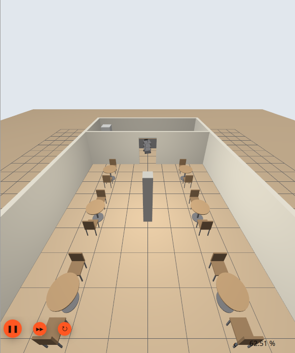
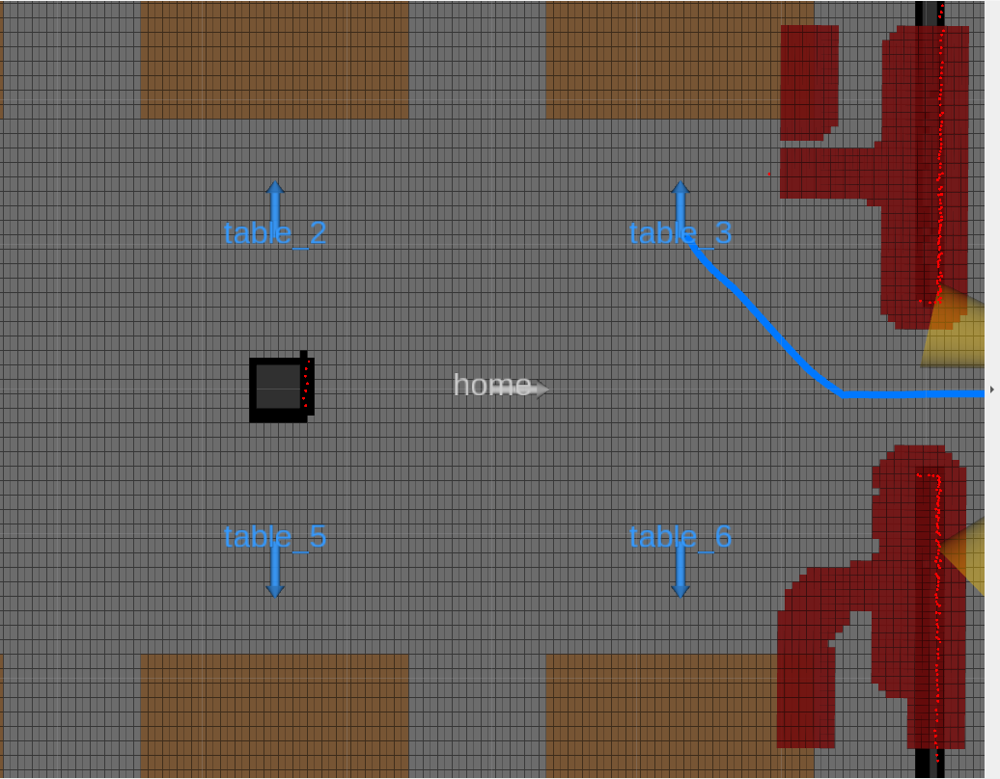
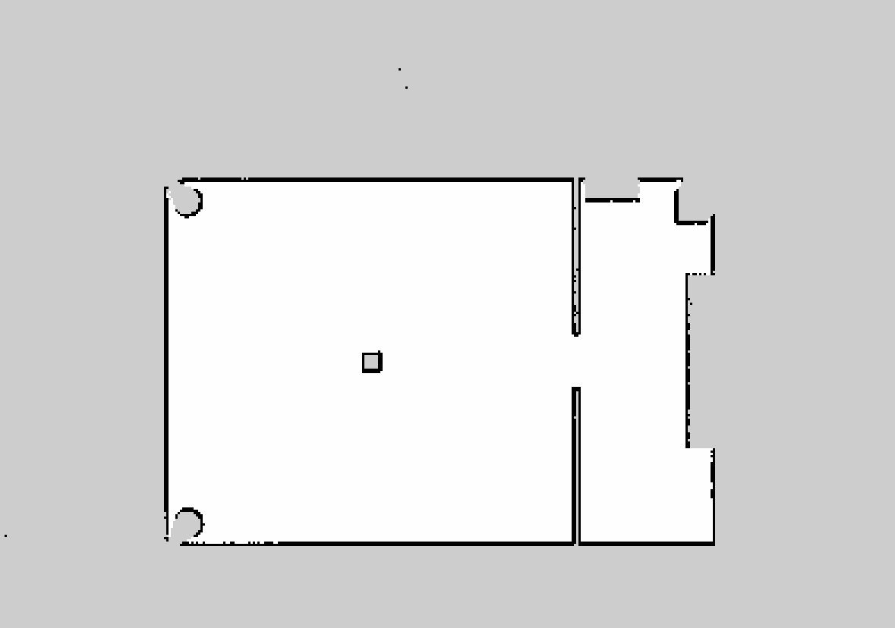
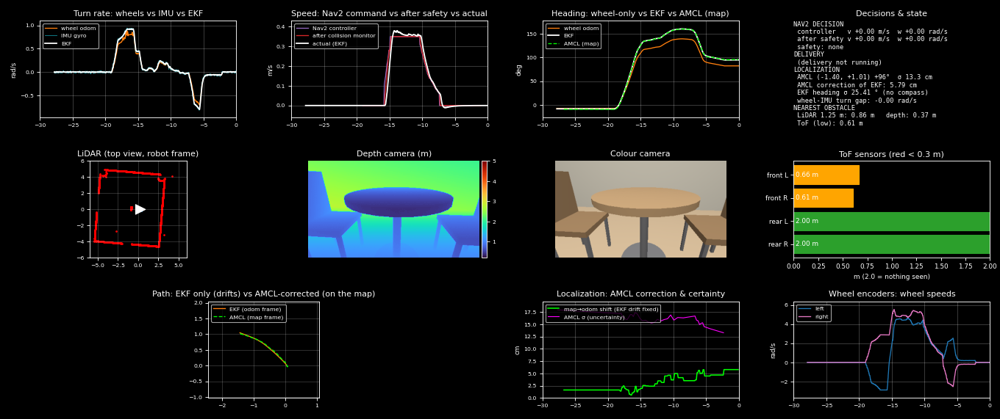
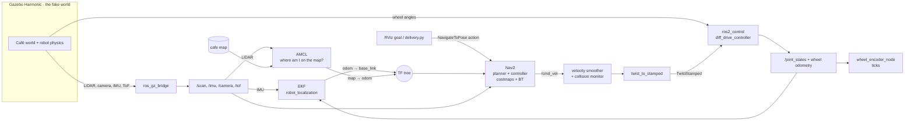

# Café Service Robot — ROS 2 Jazzy + Gazebo Harmonic Simulation

An autonomous **café delivery robot** built from scratch in simulation: it maps the café,
knows where it is, plans a safe route between tables, avoids chairs and dropped boxes, and
runs complete delivery trips (counter → tables → charger), with a live dashboard that shows
what every sensor and algorithm is doing.


| The café in Gazebo | Robot planning a route to table 3 in RViz |
|---|---|
|  |  |

| Map made by the robot (SLAM) | Live dashboard (with an injected wheel fault) |
|---|---|
|  |  |

---

## Contents
1. [What this project does](#1-what-this-project-does)
2. [The robot](#2-the-robot)
3. [How it works — the big picture](#3-how-it-works--the-big-picture)
4. [Repository layout](#4-repository-layout)
5. [Install and build](#5-install-and-build)
6. [Run it](#6-run-it)
7. [Results](#7-results)
8. [Problems we hit and how we fixed them](#8-problems-we-hit-and-how-we-fixed-them)
9. [Learn ROS 2 with this project](#9-learn-ros-2-with-this-project)
10. [Roadmap](#10-roadmap)

---

## 1. What this project does

The project went through 9 steps, each tested with measurements against Gazebo's ground truth:

| Step | What was built | Result |
|---|---|---|
| 1 | **Service robot model** (URDF/xacro): 3-tray cart, 2 BLDC rear wheels, 2 swivel front wheels, LiDAR, depth camera, IMU, encoders, 4 ToF | Spawns level, every sensor matches truth within ~2 cm |
| 2 | **Odometry + EKF** (wheel speeds + IMU yaw rate) | Odometry = truth; EKF drift 0.2 % in spins, 0.3 % in lines |
| 3 | **Café world** (generated by a Python script) | 12 × 8 m room, 6 tables, chairs, counter, kitchen, charger |
| 4 | **Mapping** with SLAM Toolbox | Final pose within 7 mm of truth |
| 5 | **Localization** with AMCL | Error 0.3–5 cm |
| 6 | **Navigation** with Nav2 (NavFn + Regulated Pure Pursuit, 3D voxel costmaps, no-go zones, collision monitor) | 7/7 goals, also with a box dropped in the aisle |
| 7 | **Named places** (counter, table_1…6, charger, home) | Arrival 4–13 cm from target |
| 8 | **Delivery routine** (single trip or "serve mode" taking orders) | Trip, confirm, bad order, blocked table all tested |
| 9 | **Live dashboard** (11 panels) + **wheel-fault demo** | EKF + IMU keep the robot on track with a 13 % odometry error |

---

## 2. The robot

| Part | Simulated as | ROS topic |
|---|---|---|
| Body | 0.60 × 0.52 m cart, 3 trays, ~31 kg | — |
| Drive | 2 rear BLDC wheels (r = 7.5 cm, 0.47 m apart) via `ros2_control` diff drive | `/diff_drive_controller/cmd_vel` |
| Front wheels | 2 passive swivel wheels | — |
| LiDAR | 360°, 720 beams, 12 m, on a mast at 1.25 m | `/scan` |
| Depth camera | RealSense-D435i-like, 0.88 m high, tilted 20° down | `/camera/...` |
| IMU | chassis centre | `/imu` |
| Wheel encoders | 1024 counts per revolution | `/left_encoder_ticks`, `/right_encoder_ticks` |
| ToF sensors | 4 corners, 12 cm high, 2 m range | `/tof_*/range` |

Limits: 0.5 m/s forward, 1.0 rad/s turning. Navigation cruises at 0.35 m/s.

> Why so many sensors? The mast LiDAR is high (1.25 m) so people don't block it — but that
> means it **cannot see tables, chairs or a box on the floor**. The depth camera and ToF
> sensors cover the low obstacles. This shaped the whole navigation design.

A second, larger robot (`robot:=amr`, 1.5 × 1.0 m warehouse AMR with two LiDARs) is also
included — it was the starting point of the project.

---

## 3. How it works — the big picture



**One goal, start to finish:**
1. You click a goal in RViz, or `delivery.py` sends one → a **`NavigateToPose` action**.
2. Nav2's **behavior tree** says: plan, then follow; if stuck, clear the costmaps and retry.
3. The **planner (NavFn)** draws a path on the **costmap** (the map plus "danger paint" from the LiDAR, depth camera and no-go zones).
4. The **controller (Regulated Pure Pursuit)** chases a point a little ahead on the path, 20 times a second → `/cmd_vel`.
5. The **velocity smoother** removes jerks; the **collision monitor** slows the robot near obstacles.
6. **`twist_to_stamped`** converts the command to the format the wheel controller needs; the wheels turn.
7. The **EKF** fuses wheel speeds + IMU → *how am I moving*; **AMCL** matches the LiDAR to the map → *where am I*.
8. The loop repeats until the robot arrives.

TF tree: `map → odom → base_link → lidar_link, camera_link, imu_link, wheels, tof_*`

More detail: [docs/ARCHITECTURE.md](docs/ARCHITECTURE.md).

---

## 4. Repository layout

```
amr_ws/
├── src/
│   ├── amr_description/    Robot models (URDF/xacro), ros2_control controller configs
│   ├── amr_bringup/        One launch file for everything, Gazebo worlds, bridge/EKF configs,
│   │                       RViz layouts, ToF converter, live dashboard, café world generator
│   ├── amr_navigation/     Maps, Nav2/SLAM/AMCL params, named places, delivery routine,
│   │                       twist_to_stamped, map_to_markers, param + zone generators
│   ├── amr_encoders/       Wheel encoder node (joint angles → ticks)
│   └── amr_encoder_msgs/   Custom message: WheelEncoderTicks (ticks, cpr)
├── tools/                  Helper scripts: stop_sim, order/done/status, goto, test & check scripts
├── docs/                   Architecture, ROS 2 concepts, development log, images
├── OPERATING_GUIDE.md      How to run every mode
├── CAFE_NAV_GUIDE.md       Step-by-step guide for the café robot
└── PROJECT_STATE.md        Detailed engineering notes and measurements
```

---

## 5. Install and build

Requires **Ubuntu 24.04** and **ROS 2 Jazzy**.

```bash
sudo apt install ros-jazzy-ros-gz ros-jazzy-gz-ros2-control ros-jazzy-ros2-controllers \
  ros-jazzy-robot-localization ros-jazzy-slam-toolbox ros-jazzy-navigation2 \
  ros-jazzy-nav2-bringup ros-jazzy-dual-laser-merger ros-jazzy-xacro python3-matplotlib

mkdir -p ~/amr_ws && cd ~/amr_ws
git clone https://github.com/shashank4521/ros2-cafe-service-robot.git .
source /opt/ros/jazzy/setup.bash
colcon build --symlink-install
source install/setup.bash
```

---

## 6. Run it

**Café robot with navigation, RViz and dashboard:**
```bash
ros2 launch amr_bringup sim.launch.py robot:=service world:=cafe nav:=true rviz:=true dashboard:=true
```
Use **2D Goal Pose** in RViz to send the robot anywhere.

**A delivery trip** (counter → table 3 → table 5 → charger):
```bash
ros2 run amr_navigation delivery table_3 table_5
```

**Serve mode** (robot waits for orders like in a real café):
```bash
ros2 run amr_navigation delivery --serve
```
```bash
ros2 topic pub -w 1 --once /delivery/order std_msgs/msg/String "{data: 'table_2 table_6'}"
```
```bash
ros2 topic pub -w 1 --once /delivery/confirm std_msgs/msg/Empty "{}"
```

**Make a new map** (SLAM mode):
```bash
ros2 launch amr_bringup sim.launch.py robot:=service world:=cafe slam:=true rviz:=true
```

**Stop everything:**
```bash
~/amr_ws/tools/stop_sim.sh
```

Launch options: `robot:=amr|service`, `world:=cafe|...`, `slam:=true`, `nav:=true`, `rviz:=true`,
`dashboard:=true`, `gui:=false` (no Gazebo window), `tof:=false`, `x:= y:= yaw:=` (spawn pose),
`wheel_fault:=1.15` (fake odometry error). Full guide: [OPERATING_GUIDE.md](OPERATING_GUIDE.md),
[CAFE_NAV_GUIDE.md](CAFE_NAV_GUIDE.md).

---

## 7. Results

| Test | Result |
|---|---|
| Navigation tour (counter, 4 tables, charger, home) | **7/7** goals reached |
| Same tour with a 0.5 m box dropped in the aisle | **7/7**, box avoided |
| Arrival accuracy | 4–13 cm from the target pose |
| AMCL localization error | 0.3–5 cm |
| Closest approach to furniture | 17 cm |
| SLAM final pose error | 7 mm / 0.014 rad |
| EKF drift | 0.2 % (spin), 0.3 % (straight line) |
| 13 % injected wheel-odometry error | EKF + AMCL still agree, all goals reached |

---

## 8. Problems we hit and how we fixed them

Each was found by measuring against Gazebo's ground truth, not by guessing.

| Symptom | Cause | Fix |
|---|---|---|
| SLAM map scattered and doubled | LiDAR merger added offsets **on top of** TF | All merger offsets = 0 |
| Robot position jumping | Two nodes published `odom → base_link` | Only the EKF publishes it (`enable_odom_tf: false`) |
| Robot tipped back, dragged its body | Casters floated 5 cm above the floor | Sphere collisions touching the floor |
| Odometry under-reported turns by 11 % | Cylinder wheels touched on the inner rim | Sphere wheel collisions |
| Robot hit a low box it had "seen" | 2D obstacle layer: high LiDAR cleared what the camera marked | **3D voxel layers** |
| Robot froze next to obstacles | Hard "stop" safety zone | Slowdown + footprint "approach" instead |
| Collision monitor stopped the robot in open space | ToF reported `inf` when clear | Report `max_range` instead |
| Front corners clipped tables when turning | Rear-axle robot: front swings out ~0.65 m | Table stops 1.05 m from table centre, 5 cm footprint padding |
| ROS nodes couldn't see each other | Stale Fast DDS shared-memory files | `stop_sim.sh` cleans `/dev/shm` |

Tried and rejected: Smac Hybrid-A\* planner (looping approaches), MPPI controller (timid,
dithering at the doorway), 10 cm padding (too strict). Full story: [docs/DEVELOPMENT_LOG.md](docs/DEVELOPMENT_LOG.md).

---

## 9. Learn ROS 2 with this project

New to ROS? [docs/ROS2_CONCEPTS.md](docs/ROS2_CONCEPTS.md) explains every ROS 2 idea used here
— nodes, topics, services, actions, parameters, launch files, TF, URDF, Gazebo, EKF, SLAM,
AMCL, Nav2 — in plain language, each one tied to a file in this repo and a command to try.

---

## 10. Roadmap

- [x] Robot model, sensors, odometry, EKF
- [x] Café world, SLAM map, AMCL
- [x] Nav2 with low-obstacle detection and no-go zones
- [x] Delivery routine and live dashboard
- [ ] Port to the real robot (Jetson, BLDC drivers, real LiDAR, RealSense, IMU, ToF)
- [ ] Touchscreen UI for staff ("Done" button, order entry)
- [ ] Docking to the charger

---

## License
MIT — see [LICENSE](LICENSE).
